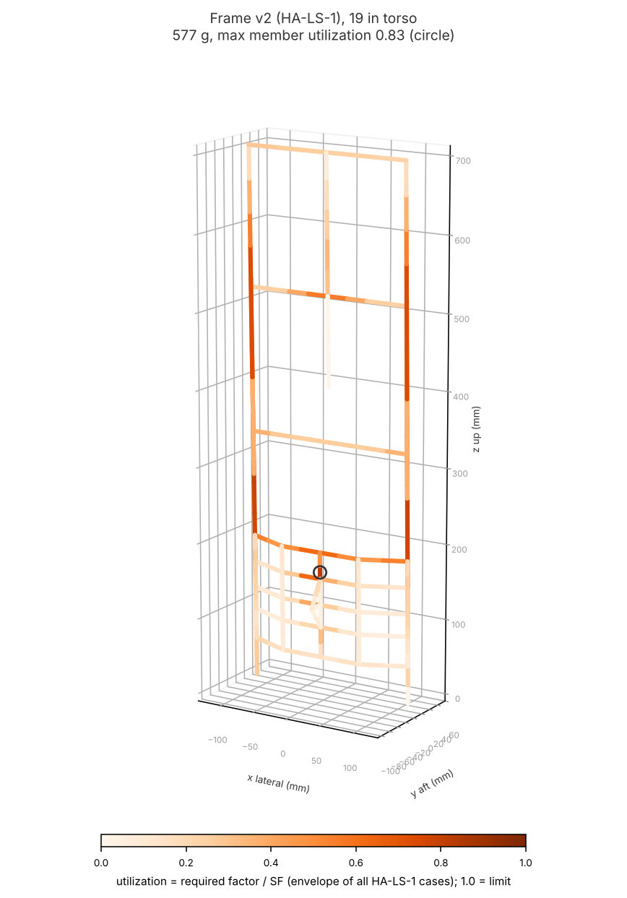
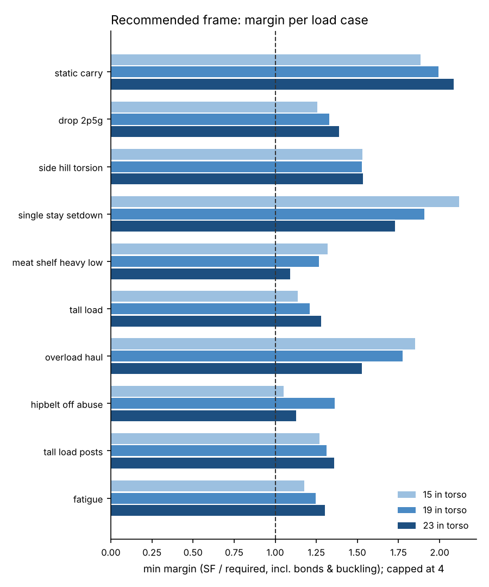
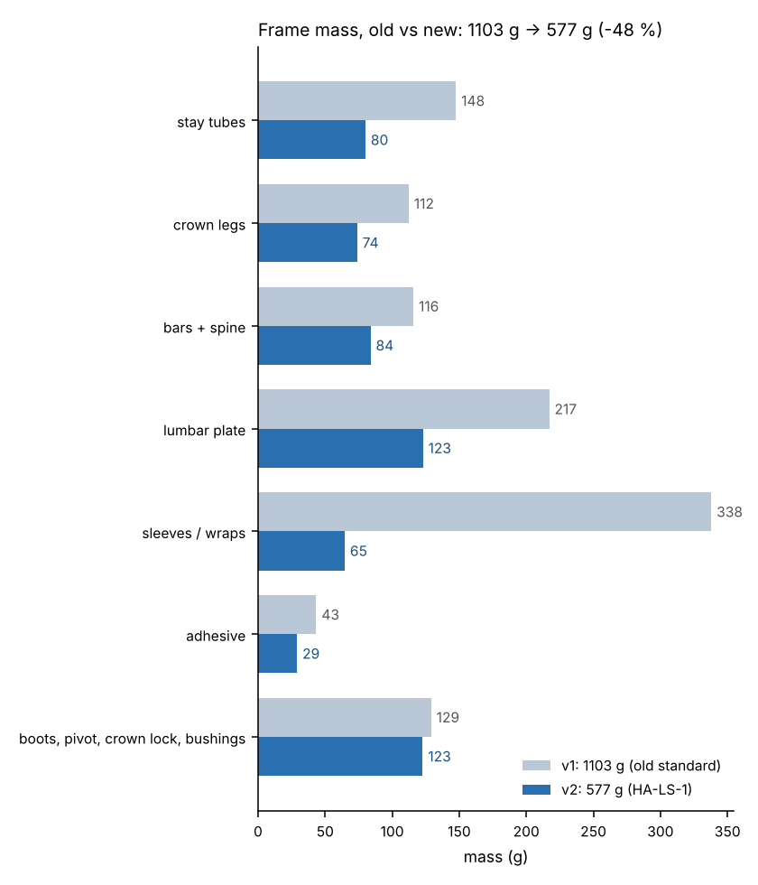
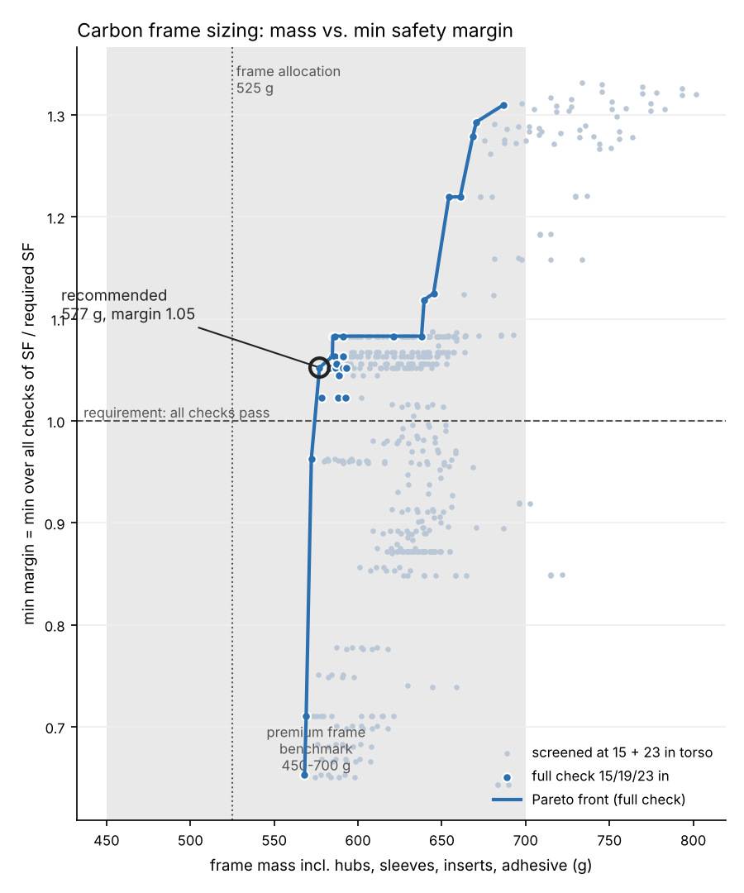

# Pack 5200 - carbon frame sizing, v2 (HA-LS-1 standard)

Owner: structural-fea-engineer. Standard: [load_standard.md](load_standard.md) (HA-LS-1, owner decision 2026-11-01 "match the leaders"). Model: `huntkit/fea/pack5200.py` (v2 options), sweep `huntkit/fea/sizing5200v2.py` (`python -m huntkit.fea.cli size5200v2`). Frame parameters: `designs/pack_5200/frame.yaml`. Hard-point changes for the pack-designer: [frame_hardpoint_changes.yaml](frame_hardpoint_changes.yaml).

## Result

**Lightest v2 frame passing every HA-LS-1 check at 15/19/23 in torso: 577 g (20.4 oz, 1.27 lb)**, down from 1103 g (-48 %). Target 550-700 g; competitor frames 450-700 g (KUIU ICON 6 frame 13.7 oz = 388 g; SG Krux 2 lb 7 oz incl. belt + harness).

- Design: stay 20 RW0 k3 (0.81) | leg 16 RW45 k6 (1.19) | bars 18 RW45 k4 (0.94) | plate QI 1.5 | spine tube 20 RW45 k4 (0.94) | mma | sleeve 0.75 | bushing 70 | upper bar 22 RW45 k4 (0.94) | straight | CF wrap | flange 25 pad 1 | contact 60 deg | low bush leg_end
- Min margin (SF / required, all checks, 15/19/23 in): **1.05**, governing `hipbelt_off_abuse: member UB1-UB2` at 15 in.

| check | min margin |
|---|---|
| member | 1.05 |
| buckling | 1.56 |
| bond avg | 4.26 |
| bond peak | 1.73 |
| crown | 1.79 |
| plate | 2.24 |
| plate buckling | 1.26 |
| fatigue | 1.18 |

### Min margin per load case (all torsos)

| case | g x factor | 15 in | 19 in | 23 in |
|---|---|---|---|---|
| static_carry | 68 kg x 1 g x 2 | 1.88 | 1.99 | 2.08 |
| drop_2p5g | 68 kg x 2 g x 1.5 | 1.26 | 1.33 | 1.39 |
| side_hill_torsion | 68 kg x 1.6 g x 1.5 | 1.53 | 1.53 | 1.53 |
| single_stay_setdown | 68 kg x 2 g x 1.5 | 2.12 | 1.91 | 1.73 |
| meat_shelf_heavy_low | 68 kg x 2 g x 1.5 | 1.32 | 1.27 | 1.09 |
| tall_load | 68 kg x 2 g x 1.5 | 1.14 | 1.21 | 1.28 |
| tall_load_posts | 68 kg x 2 g x 1.5 | 1.27 | 1.31 | 1.36 |
| overload_haul | 91 kg x 1.6 g x 1 | 1.85 | 1.78 | 1.53 |
| hipbelt_off_abuse | 68 kg x 1.5 g x 1 | 1.05 | 1.36 | 1.13 |
| fatigue (1e5 x 0->1.6 g) | - | 1.18 | 1.24 | 1.30 |

## Old vs. new

| | v1 (old standard) | v2 (HA-LS-1) |
|---|---|---|
| standard | 7 cases, 2.5 g x SF 2.0 (5.0 x rated), bond peak >= 2.0, buckling >= 3.0 | static 2.0 x rated; stumble / set-down / shelf / tall load 2.0 g x 1.5 (3.0 x rated); side-hill 1.6 g x 1.5; overload 91 kg x 1.6 g and hipbelt-off 1.5 g at 1.0 (ultimate); bond peak >= 1.0 at limit; buckling >= 1.5 x factor; fatigue 1e5 x 1.6 g |
| stays | segmented (lower + upper, bonded 7075 elbow) | one straight tube per side |
| joints | 7075 sleeves / sockets / collars, 2 mm | carbon wraps |
| lumbar plate | 4 mm flat QI, 217 g | formed QI pan + flanges + pivot pad-up |
| crown bushings | 70 mm, low bushing fixed at z 380, point-contact ring formula | leg-end low bushing, 70 mm, 120 deg contact land |
| mass | 1103 g | **577 g** |
| min margin under its own standard | 1.09 | 1.05 |
| min margin under the OTHER standard | 1.10 (v1 design under HA-LS-1; governing `hipbelt_off_abuse: crown bush_top_L: leg ring crush at bushing`) | 0.65 (v2 design under the old standard; governing `meat_shelf_heavy_low: member SR290-SR330`) |

Where the 1103 -> 577 g came from: **neither change alone gets there.** The v1 design re-checked against HA-LS-1 has only 1.10 margin (governing `hipbelt_off_abuse: crown bush_top_L: leg ring crush at bushing`): the hipbelt-off abuse case is unchanged by the new standard (1.5 g x 1.0 in both) and, with the point-load ring formula and the 7075 parts, it sizes the v1 crown just as before. The v2 topology checked against the OLD standard has 0.65 margin. The saving is the combination: HA-LS-1 cuts the dynamic design loads 40 % (5.0x -> 3.0x rated) and the Volkersen-peak requirement 2x, and the topology changes delete the parasitic mass that no tube size could remove (7075 sleeves 338 -> 65 g as carbon wraps, flat 4 mm plate 217 -> 123 g as a formed pan, elbow joints gone, leg-end bushings unload the crown legs).

### Reference values for the physical tests (load_standard.md section 5)

- T1(a) 150 lb static carry, 15 in torso: crown top bar centre moves +44.7 mm fore-aft (+ = away from the back), -3.9 mm vertical relative to the hipbelt pivot; lumbar pan centre +0.0 mm fore-aft. Most of it is the frame rotating on the modelled body springs (hipbelt foam, harness), so the rig reading depends on how stiff the hip log and shoulder bar are: treat it as an order-of-magnitude check (+-50 %) and use YOUR first 150 lb reading as the baseline for the 10 % stiffness-change and permanent-set criteria. At 300 lb expect ~2x (linear).
- T1(a) 150 lb static carry, 19 in torso: crown top bar centre moves +34.3 mm fore-aft (+ = away from the back), -2.6 mm vertical relative to the hipbelt pivot; lumbar pan centre +0.0 mm fore-aft. Most of it is the frame rotating on the modelled body springs (hipbelt foam, harness), so the rig reading depends on how stiff the hip log and shoulder bar are: treat it as an order-of-magnitude check (+-50 %) and use YOUR first 150 lb reading as the baseline for the 10 % stiffness-change and permanent-set criteria. At 300 lb expect ~2x (linear).
- T1(a) 150 lb static carry, 23 in torso: crown top bar centre moves +27.9 mm fore-aft (+ = away from the back), -2.1 mm vertical relative to the hipbelt pivot; lumbar pan centre +0.0 mm fore-aft. Most of it is the frame rotating on the modelled body springs (hipbelt foam, harness), so the rig reading depends on how stiff the hip log and shoulder bar are: treat it as an order-of-magnitude check (+-50 %) and use YOUR first 150 lb reading as the baseline for the 10 % stiffness-change and permanent-set criteria. At 300 lb expect ~2x (linear).
- T7 bushing crush coupon: max FEA bushing radial force 997 N (hipbelt_off_abuse 15 in, bush_top_L); test to **1495 N** with no crack and <= 0.2 mm ovalisation after unload, then to failure.
- T6 joint coupons, largest FEA end force per joint type (all HA-LS-1 cases, limit loads):
  - crown_corner: axial 119 N (with 1.2 N m bending, side_hill_torsion 15 in) -> mean coupon pull-out >= 178 N, lowest >= 148 N
  - foot: axial 1333 N (with 0.0 N m bending, single_stay_setdown 19 in) -> mean coupon pull-out >= 2000 N, lowest >= 1667 N
  - mid_hub: axial 362 N (with 1.9 N m bending, overload_haul 23 in) -> mean coupon pull-out >= 543 N, lowest >= 453 N
  - post_socket: axial 30 N (with 4.1 N m bending, tall_load_posts 15 in) -> mean coupon pull-out >= 45 N, lowest >= 37 N
  - stay_top: axial 19 N (with 0.0 N m bending, hipbelt_off_abuse 15 in) -> mean coupon pull-out >= 28 N, lowest >= 23 N
  - upper_hub: axial 419 N (with 15.0 N m bending, hipbelt_off_abuse 23 in) -> mean coupon pull-out >= 629 N, lowest >= 524 N

### Mass breakdown (v2)

| item | g | oz |
|---|---|---|
| tubes: stay_lower | 19.6 | 0.69 |
| tubes: stay_upper | 60.4 | 2.13 |
| tubes: mid_bar | 17.9 | 0.63 |
| tubes: upper_bar | 22.1 | 0.78 |
| tubes: crown_leg | 73.8 | 2.60 |
| tubes: crown_top_bar | 17.9 | 0.63 |
| tubes: crown_spine | 26.0 | 0.92 |
| lumbar plate (250 x 140) + 2 x 25 mm flanges | 110.4 | 3.90 |
| lumbar pivot pad-up (CF) | 12.5 | 0.44 |
| carbon wraps (sleeves/hubs) + gussets | 64.6 | 2.28 |
| adhesive (incl. lumbar-plate bond) | 29.1 | 1.03 |
| foot boots (2) | 28.0 | 0.99 |
| Ti hipbelt pivot insert | 28.0 | 0.99 |
| crown rack + pawl housing + pulley guides | 44.0 | 1.55 |
| UHMWPE bushings (4) | 16.7 | 0.59 |
| spine clamp | 6.0 | 0.21 |
| **total (extension posts excluded)** | **577.0** | **20.4** |

### Sensitivity: the 120 deg bushing contact credit

Without the contact credit (point-load ring formula, 0.318 F R) the same frame has min margin **0.91** (governing `hipbelt_off_abuse: crown bush_top_L: stay ring crush under the wrap collar`). So the credit IS load-bearing: the bushing crush coupon (load_standard.md T7) must pass before release, or step the crown leg wall up one ply.

## Proposed further mass reductions (keep the margins)

1. **Fatigue / walking-peak tests first.** If T5 (cycle test) passes at 1.6 g with no stiffness loss, the fatigue screen (CFRP FI <= 0.5 at the walking peak) can be relaxed to the measured value; it is the most conservative assumption left in HA-LS-1.
2. **Pulley shares the crown load.** The pawl is assumed to carry 100 % (pulley slack). A pre-tensioned 3:1 pulley carries part of it; measured in T1 with a luggage scale on the pulley tail, this unloads the upper bar and spine.
3. **Joint coupons (T6) earn the scarfed-wrap credit** (~2x lower Volkersen peak): thinner wraps (0.5 mm) at the hubs, ~10-15 g.
4. **Formed / corrugated sections** (KUIU ICON 6 style thermoplastic corrugated sheet) need press tooling: not buildable in the owner's no-autoclave shop now; the formed lumbar pan is the one place it pays. Revisit for production tooling (a corrugated one-piece lower frame could replace plate + lower stays).
5. **Hardware** (foot boots 28 g, pivot insert, rack + pawl 44 g) is now ~25 % of the frame; a lighter printed-nylon rack and a 3D-printed Ti pivot are the next 20-30 g.

## Crown retention (for the pulley / rack-and-pawl sizing)

| case | pawl force N (+ extension / - compression) | torso in |
|---|---|---|
| static_carry | 33 | 23 |
| drop_2p5g | 65 | 23 |
| side_hill_torsion | 51 | 15 |
| single_stay_setdown | -200 | 23 |
| meat_shelf_heavy_low | 264 | 23 |
| tall_load | 267 | 15 |
| overload_haul | 283 | 23 |
| hipbelt_off_abuse | 850 | 19 |
| tall_load_posts | 266 | 23 |

- Max extension 850 N, max compression 200 N (HA-LS-1 limit loads, pulley assumed slack). Rack rating 5328 N.

### Telescoping crown checks (23 in and 15 in, left side)

| case | torso | check | value | SF |
|---|---|---|---|---|
| drop_2p5g | 15 | bush_low_L: UHMWPE bushing bearing | 0.0 MPa | 849.26 |
| drop_2p5g | 15 | bush_low_L: stay ring crush at bushing | 0.6 N*mm/mm | 48.12 |
| drop_2p5g | 15 | bush_low_L: leg ring crush at bushing | 0.5 N*mm/mm | 81.16 |
| drop_2p5g | 15 | bush_top_L: UHMWPE bushing bearing | 0.1 MPa | 185.59 |
| drop_2p5g | 15 | bush_top_L: carbon-wrap stay-top collar ring bending | 8.4 MPa | 27.78 |
| drop_2p5g | 15 | bush_top_L: stay ring crush under the wrap collar | 1.9 N*mm/mm | 14.11 |
| drop_2p5g | 15 | bush_top_L: leg ring crush at bushing | 2.1 N*mm/mm | 17.74 |
| meat_shelf_heavy_low | 15 | bush_low_L: UHMWPE bushing bearing | 0.0 MPa | 2547.85 |
| meat_shelf_heavy_low | 15 | bush_low_L: stay ring crush at bushing | 0.2 N*mm/mm | 144.36 |
| meat_shelf_heavy_low | 15 | bush_low_L: leg ring crush at bushing | 0.2 N*mm/mm | 243.49 |
| meat_shelf_heavy_low | 15 | bush_top_L: UHMWPE bushing bearing | 0.1 MPa | 318.02 |
| meat_shelf_heavy_low | 15 | bush_top_L: carbon-wrap stay-top collar ring bending | 4.9 MPa | 47.60 |
| meat_shelf_heavy_low | 15 | bush_top_L: stay ring crush under the wrap collar | 1.1 N*mm/mm | 24.18 |
| meat_shelf_heavy_low | 15 | bush_top_L: leg ring crush at bushing | 1.2 N*mm/mm | 30.39 |
| hipbelt_off_abuse | 15 | bush_low_L: UHMWPE bushing bearing | 0.2 MPa | 116.94 |
| hipbelt_off_abuse | 15 | bush_low_L: stay ring crush at bushing | 4.3 N*mm/mm | 6.63 |
| hipbelt_off_abuse | 15 | bush_low_L: leg ring crush at bushing | 3.3 N*mm/mm | 11.18 |
| hipbelt_off_abuse | 15 | bush_top_L: UHMWPE bushing bearing | 0.9 MPa | 23.60 |
| hipbelt_off_abuse | 15 | bush_top_L: carbon-wrap stay-top collar ring bending | 66.2 MPa | 3.53 |
| hipbelt_off_abuse | 15 | bush_top_L: stay ring crush under the wrap collar | 15.3 N*mm/mm | 1.79 |
| hipbelt_off_abuse | 15 | bush_top_L: leg ring crush at bushing | 16.3 N*mm/mm | 2.26 |
| drop_2p5g | 23 | bush_low_L: UHMWPE bushing bearing | 0.0 MPa | 765.06 |
| drop_2p5g | 23 | bush_low_L: stay ring crush at bushing | 0.7 N*mm/mm | 43.35 |
| drop_2p5g | 23 | bush_low_L: leg ring crush at bushing | 0.5 N*mm/mm | 73.11 |
| drop_2p5g | 23 | bush_top_L: UHMWPE bushing bearing | 0.0 MPa | 421.61 |
| drop_2p5g | 23 | bush_top_L: carbon-wrap stay-top collar ring bending | 3.7 MPa | 63.11 |
| drop_2p5g | 23 | bush_top_L: stay ring crush under the wrap collar | 0.9 N*mm/mm | 32.06 |
| drop_2p5g | 23 | bush_top_L: leg ring crush at bushing | 0.9 N*mm/mm | 40.29 |
| meat_shelf_heavy_low | 23 | bush_low_L: UHMWPE bushing bearing | 0.2 MPa | 110.14 |
| meat_shelf_heavy_low | 23 | bush_low_L: stay ring crush at bushing | 4.5 N*mm/mm | 6.24 |
| meat_shelf_heavy_low | 23 | bush_low_L: leg ring crush at bushing | 3.5 N*mm/mm | 10.53 |
| meat_shelf_heavy_low | 23 | bush_top_L: UHMWPE bushing bearing | 0.3 MPa | 67.16 |
| meat_shelf_heavy_low | 23 | bush_top_L: carbon-wrap stay-top collar ring bending | 23.3 MPa | 10.05 |
| meat_shelf_heavy_low | 23 | bush_top_L: stay ring crush under the wrap collar | 5.4 N*mm/mm | 5.11 |
| meat_shelf_heavy_low | 23 | bush_top_L: leg ring crush at bushing | 5.7 N*mm/mm | 6.42 |
| hipbelt_off_abuse | 23 | bush_low_L: UHMWPE bushing bearing | 0.3 MPa | 63.53 |
| hipbelt_off_abuse | 23 | bush_low_L: stay ring crush at bushing | 7.8 N*mm/mm | 3.60 |
| hipbelt_off_abuse | 23 | bush_low_L: leg ring crush at bushing | 6.0 N*mm/mm | 6.07 |
| hipbelt_off_abuse | 23 | bush_top_L: UHMWPE bushing bearing | 0.5 MPa | 41.49 |
| hipbelt_off_abuse | 23 | bush_top_L: carbon-wrap stay-top collar ring bending | 37.7 MPa | 6.21 |
| hipbelt_off_abuse | 23 | bush_top_L: stay ring crush under the wrap collar | 8.7 N*mm/mm | 3.15 |
| hipbelt_off_abuse | 23 | bush_top_L: leg ring crush at bushing | 9.3 N*mm/mm | 3.96 |

### Lumbar plate checks (19 in)

| case | check | value | SF |
|---|---|---|---|
| drop_2p5g | lumbar plate in-plane shear | 8.7 MPa | 16.35 |
| drop_2p5g | lumbar plate shear buckling (req. 3.0) | 8.7 MPa | 3.65 |
| drop_2p5g | lumbar plate-to-stay bond avg (SL190) | 3.7 MPa | 4.34 |
| drop_2p5g | lumbar plate-to-stay bond Volkersen peak (SL190) | 5.3 MPa | 2.99 |
| drop_2p5g | Ti pivot insert punching shear in lumbar plate (D30 flange) | 7.6 MPa | 18.90 |
| side_hill_torsion | lumbar plate in-plane shear | 7.6 MPa | 18.70 |
| side_hill_torsion | lumbar plate shear buckling (req. 3.0) | 7.6 MPa | 4.17 |
| side_hill_torsion | lumbar plate-to-stay bond avg (SL190) | 3.2 MPa | 4.95 |
| side_hill_torsion | lumbar plate-to-stay bond Volkersen peak (SL190) | 4.7 MPa | 3.41 |
| side_hill_torsion | Ti pivot insert punching shear in lumbar plate (D30 flange) | 5.8 MPa | 24.52 |
| single_stay_setdown | lumbar plate in-plane shear | 3.1 MPa | 45.70 |
| single_stay_setdown | lumbar plate shear buckling (req. 3.0) | 3.1 MPa | 10.19 |
| single_stay_setdown | lumbar plate-to-stay bond avg (SL50) | 2.6 MPa | 6.13 |
| single_stay_setdown | lumbar plate-to-stay bond Volkersen peak (SL50) | 4.1 MPa | 3.90 |
| single_stay_setdown | Ti pivot insert punching shear in lumbar plate (D30 flange) | 0.0 MPa | inf |
| tall_load | lumbar plate in-plane shear | 10.6 MPa | 13.50 |
| tall_load | lumbar plate shear buckling (req. 3.0) | 10.6 MPa | 3.01 |
| tall_load | lumbar plate-to-stay bond avg (SL190) | 4.2 MPa | 3.84 |
| tall_load | lumbar plate-to-stay bond Volkersen peak (SL190) | 6.0 MPa | 2.65 |
| tall_load | Ti pivot insert punching shear in lumbar plate (D30 flange) | 7.6 MPa | 18.87 |

## Stock list

| part | qty | section | wall mm | layup (inner -> outer) | centreline mm | cut mm | source |
|---|---|---|---|---|---|---|---|
| stay, straight (foot boot -> stay-top wrap collar) | 2 | OD 20 mm round | 0.81 | [twill 0/90 / UD 0 x3 / twill 0/90] | 530 | 525 | standard roll-wrapped stock (twill 0/90 outer + UD core), e.g. Rock West / DragonPlate catalogue |
| crown leg (telescoping, low bushing bonded on its bottom end) | 2 | OD 16 mm round | 1.19 | [twill +-45 / UD 0 x6 / twill +-45] | 430 | 430 | roll-wrapped, +-45 twill wraps over a UD core (special-order wrap from the same vendors) |
| mid bar (z 330) | 1 | OD 18 mm round | 0.94 | [twill +-45 / UD 0 x4 / twill +-45] | 230 | 210 | roll-wrapped, +-45 twill wraps over a UD core (special-order wrap from the same vendors) |
| upper bar (z 520, pawl housing) | 1 | OD 22 mm round | 0.94 | [twill +-45 / UD 0 x4 / twill +-45] | 230 | 210 | roll-wrapped, +-45 twill wraps over a UD core (special-order wrap from the same vendors) |
| crown top bar | 1 | OD 18 mm round | 0.94 | [twill +-45 / UD 0 x4 / twill +-45] | 230 | 214 | roll-wrapped, +-45 twill wraps over a UD core (special-order wrap from the same vendors) |
| crown spine tube (rack bonded on) | 1 | OD 20 mm round | 0.94 | [twill +-45 / UD 0 x4 / twill +-45] | 300 | 300 | roll-wrapped, +-45 twill wraps over a UD core (special-order wrap from the same vendors) |
| lumbar pan blank | 1 | 250 x 190 mm before forming | 1.5 | QI twill (0/90, +-45) wet layup over a foam / MDF male mould | - | - | owner layup |

## Joint design

- **adhesive**: adhesive_methacrylate_ma (tube-to-tube fit-up, fillets) + wet-layup epoxy for the wraps
- **bondline_mm**: 0.5
- **adhesive_shear_modulus_mpa_ASSUMPTION**: 300.0
- **wrap**: cfrp_plate_quasi_iso-equivalent wrap, 0.75 mm = 3 plies 3k twill alternating 0/90 and +-45, wet-laid (or prepreg) over sanded tubes, peel-ply + shrink tape, room-temp cure + 65 C post-cure
- **wrap_overlap_mm**: 30 on each tube (through-joints 40); wrap ends scarfed / ply-dropped over 8 mm (peel relief, not credited)
- **stay**: ONE straight tube per side, foot boot -> stay top (no lumbar elbow)
- **foot_boot**: 7075 boot bonded 25 mm over the stay foot, carries the shelf-pivot boss 20 mm outboard (keeps the shelf pivot at x +-135) + bumper
- **mid_hub / upper_hub**: bar end coped (fish-mouthed) to the stay, tacked with MMA, then carbon-wrapped (tube-to-tube, bicycle-frame style); CF gusset in the wrap
- **stay_top_collar**: carbon wrap 0.75 mm over the stay top; UHMWPE bushing 70 mm with a 120 deg contact land seats inside
- **low_bushing**: UHMWPE 70 mm sleeve bonded on the crown-leg bottom end (slides in the stay bore)
- **crown_corner**: leg top + top bar coped and wrapped; extension-post socket = short 7075 liner inside the wrap
- **lumbar_plate**: formed QI CFRP pan 1.5 mm, return flanges 25 mm top + bottom, face 25 mm toward the body; lands bonded to both stays z 50-190; CF pad-up 1 mm behind the Ti pivot insert
- **galvanic**: no bare Al on carbon: anodise + glass-bead bondline / E-glass ply under any Al liner

## Sizing sweep

Stage A: stays 20/22/25 mm x RW0/RW45/UD90 x walls 0.8-1.5 mm, legs = largest buyable OD in the bore (>= 0.75 mm bushing) x 3 walls. Stage B: bars 16/18, upper bar 20/22 mm, spine 18/20 mm. Stage C: plate 1.5/2.0 mm x flange 15/20/25 x pad-up 1.0/1.5 x wrap 0.75/1.0 mm x bushing 70/110 mm (base 90). A-C screened at 15 + 23 in; stage D re-ran the lightest feasible and the Pareto set at 15/19/23 in.

Evaluated: 504 screened, 28 full checks.

| mass g | min margin | governing | design |
|---|---|---|---|
| 568 | 0.65 | tall_load: member plh42 (15 in) | stay 20 RW0 k3 (0.81) | leg 16 RW45 k6 (1.19) | bars 18 RW45 k4 (0.94) | plate QI 1.5 | spine tube 20 RW45 k4 (0.94) | mma | sleeve 0.75 | bushing 70 | upper bar 22 RW45 k4 (0.94) | straight | CF wrap | flange 15 pad 1 | contact 60 deg | low bush leg_end |
| 569 | 0.71 | hipbelt_off_abuse: crown bush_top_R: stay ring crush under the wrap collar (15 in) | stay 22 UD90 k3 (0.75) | leg 19 RW45 k4 (0.94) | bars 18 RW45 k4 (0.94) | plate QI 1.5 | spine tube 20 RW45 k4 (0.94) | mma | sleeve 0.75 | bushing 70 | upper bar 22 RW45 k4 (0.94) | straight | CF wrap | flange 15 pad 1 | contact 60 deg | low bush leg_end |
| 572 | 0.96 | tall_load: member plv32 (15 in) | stay 20 RW0 k3 (0.81) | leg 16 RW45 k6 (1.19) | bars 18 RW45 k4 (0.94) | plate QI 1.5 | spine tube 20 RW45 k4 (0.94) | mma | sleeve 0.75 | bushing 70 | upper bar 22 RW45 k4 (0.94) | straight | CF wrap | flange 20 pad 1 | contact 60 deg | low bush leg_end |
| 577 | 1.05 | hipbelt_off_abuse: member UB1-UB2 (15 in) | stay 20 RW0 k3 (0.81) | leg 16 RW45 k6 (1.19) | bars 18 RW45 k4 (0.94) | plate QI 1.5 | spine tube 20 RW45 k4 (0.94) | mma | sleeve 0.75 | bushing 70 | upper bar 22 RW45 k4 (0.94) | straight | CF wrap | flange 25 pad 1 | contact 60 deg | low bush leg_end |
| 578 | 1.02 | tall_load: member plh42 (15 in) | stay 20 RW0 k3 (0.81) | leg 16 RW45 k6 (1.19) | bars 18 RW45 k4 (0.94) | plate QI 1.5 | spine tube 20 RW45 k4 (0.94) | mma | sleeve 0.75 | bushing 70 | upper bar 22 RW45 k4 (0.94) | straight | CF wrap | flange 20 pad 1.5 | contact 60 deg | low bush leg_end |
| 583 | 1.05 | hipbelt_off_abuse: member UB1-UB2 (15 in) | stay 20 RW0 k3 (0.81) | leg 16 RW45 k6 (1.19) | bars 18 RW45 k4 (0.94) | plate QI 1.5 | spine tube 20 RW45 k4 (0.94) | mma | sleeve 0.75 | bushing 70 | upper bar 22 RW45 k4 (0.94) | straight | CF wrap | flange 25 pad 1.5 | contact 60 deg | low bush leg_end |
| 585 | 1.06 | hipbelt_off_abuse: member UB1-UB2 (15 in) | stay 22 RW0 k3 (0.81) | leg 18 RW45 k4 (0.94) | bars 18 RW45 k4 (0.94) | plate QI 1.5 | spine tube 20 RW45 k4 (0.94) | mma | sleeve 0.75 | bushing 70 | upper bar 22 RW45 k4 (0.94) | straight | CF wrap | flange 25 pad 1 | contact 60 deg | low bush leg_end |
| 585 | 1.08 | hipbelt_off_abuse: member SP81-SP150 (15 in) | stay 22 UD90 k3 (0.75) | leg 19 RW45 k4 (0.94) | bars 18 RW45 k4 (0.94) | plate QI 1.5 | spine tube 20 RW45 k4 (0.94) | mma | sleeve 0.75 | bushing 110 | upper bar 22 RW45 k4 (0.94) | straight | CF wrap | flange 25 pad 1 | contact 60 deg | low bush leg_end |
| 586 | 1.06 | tall_load: member plh41 (15 in) | stay 22 RW0 k3 (0.81) | leg 18 RW45 k4 (0.94) | bars 18 RW45 k4 (0.94) | plate QI 1.5 | spine tube 20 RW45 k4 (0.94) | mma | sleeve 0.75 | bushing 70 | upper bar 22 RW45 k4 (0.94) | straight | CF wrap | flange 20 pad 1.5 | contact 60 deg | low bush leg_end |
| 586 | 1.08 | hipbelt_off_abuse: member SP81-SP150 (15 in) | stay 22 UD90 k3 (0.75) | leg 19 RW45 k4 (0.94) | bars 18 RW45 k4 (0.94) | plate QI 1.5 | spine tube 20 RW45 k4 (0.94) | mma | sleeve 0.75 | bushing 110 | upper bar 22 RW45 k4 (0.94) | straight | CF wrap | flange 20 pad 1.5 | contact 60 deg | low bush leg_end |
| 587 | 1.05 | hipbelt_off_abuse: member UB1-UB2 (15 in) | stay 20 RW0 k3 (0.81) | leg 16 RW45 k6 (1.19) | bars 18 RW45 k4 (0.94) | plate QI 1.5 | spine tube 20 RW45 k4 (0.94) | mma | sleeve 0.75 | bushing 110 | upper bar 22 RW45 k4 (0.94) | straight | CF wrap | flange 25 pad 1 | contact 60 deg | low bush leg_end |
| 587 | 1.06 | hipbelt_off_abuse: member UB0-UB1 (15 in) | stay 20 RW0 k4 (0.94) | leg 16 RW45 k6 (1.19) | bars 18 RW45 k4 (0.94) | plate QI 1.5 | spine tube 20 RW45 k4 (0.94) | mma | sleeve 0.75 | bushing 70 | upper bar 22 RW45 k4 (0.94) | straight | CF wrap | flange 25 pad 1 | contact 60 deg | low bush leg_end |

## Assumptions and caveats

- Load cases and factors: `huntkit/fea/load_standard.py` (HA-LS-1); rationale and sources in load_standard.md.
- ASSUMPTION: straight stay foot moved to x +-115 (in-line under the stay top) so the crown legs stay parallel; shelf pivots stay at x +-135 on a 20 mm boot boss (boss not modelled; it is a 7075 part).
- ASSUMPTION: the formed lumbar pan is a grillage in the plate face, offset toward the body by the flange depth; top/bottom edge strips are L-sections (web + return flange); the land-to-face transition is the inclined end strip. +-30 % on plate stresses; shell-model check before release.
- ASSUMPTION: bushing contact pressure is a half-cosine over a 120 deg land (ring moment 0.154 F R, `huntkit.fea.rings`, verified against Roark's point-load ring). Needs the T7 crush coupon.
- ASSUMPTION: carbon wrap = QI CFRP (`cfrp_plate_quasi_iso`: E 45 GPa) in the Volkersen model; the bond allowable is still the MMA lap-shear on CFRP x 0.8 hot/wet (wet-layup epoxy onto sanded CFRP is similar). Wrap-collar ring check shares the ring moment with the stay wall by E t^3 (no composite action credited).
- ASSUMPTION: adhesive moduli (MMA 300 MPa) as v1; hardware masses +-30 %; Ti pivot boss grows 0.35 g per mm of extra standoff.
- Same bag-load split, body springs and hip share (80 %) as v1 (see the v1 notes kept in git history).
- Not modelled: peel at wrap ends, local hub stresses, the yoke plate, the extension posts beyond the `tall_load_posts` case.
