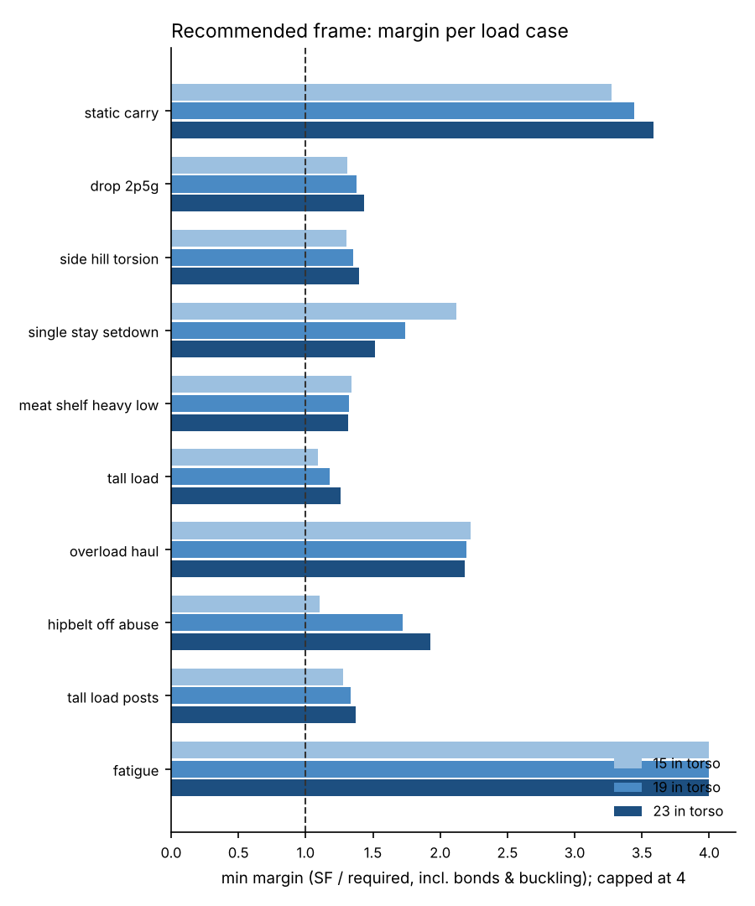
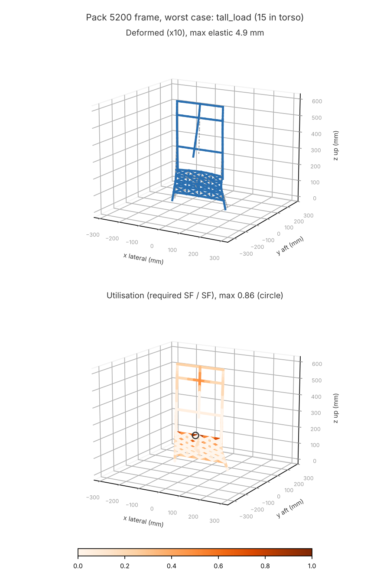
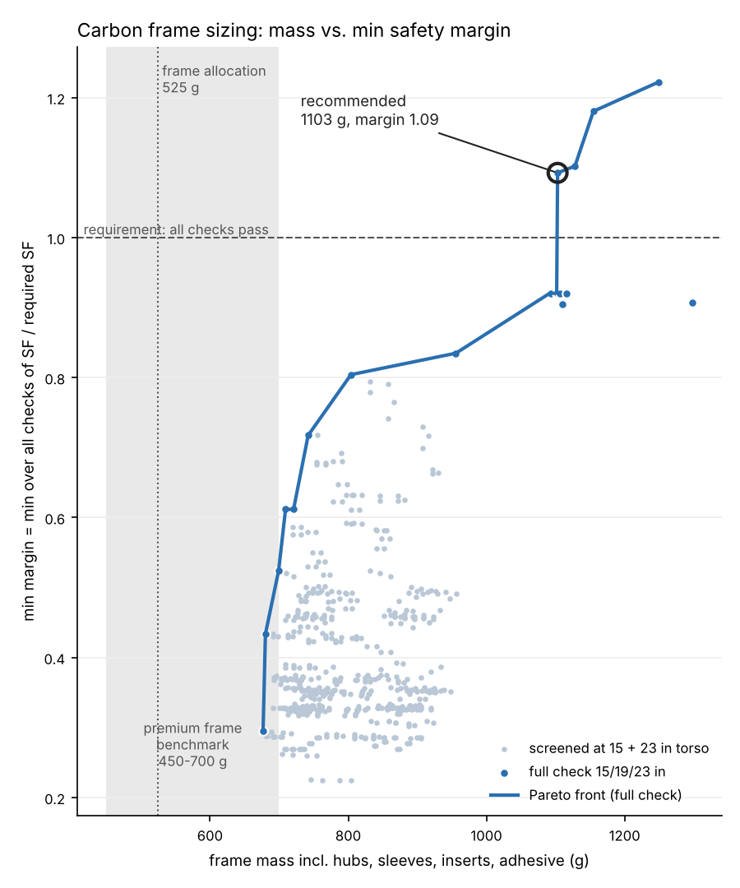

# Pack 5200 - carbon frame sizing (pack-designer topology)

Owner: structural-fea-engineer. Model: `huntkit/fea/pack5200.py` built from `designs/pack_5200/geometry.yaml`. Sweep: `huntkit/fea/sizing5200.py` (`python -m huntkit.fea.cli size5200`). Frame parameters: `designs/pack_5200/frame.yaml`.

## Result

**Lightest design that passes every check: 1103 g (38.9 oz, 2.43 lb).** That is OVER the 525 g allocation by 578 g. The R-15 limit is 600 g, and the premium-frame benchmark is 450-700 g.

### Why it is heavy, and the path to the 525-600 g target

The three largest mass items are 7075 sockets/sleeves + gussets (338 g), lumbar plate (250 x 140) (217 g), tubes: crown_leg (112 g). The checks that set the mass are the Volkersen PEAK bond shear at the lumbar elbows (tall_load, 15 in), the crown-leg ring crush at the stay-top bushing (hipbelt-off abuse) and lumbar-plate bending at its free top edge. None of these can be fixed by tube size alone. These changes go to the pack-designer:
1. **Delete the lumbar elbows.** Use one straight stay per side from the foot boot to the stay top, with the lumbar curve in the foam. The elbow is the governing bond, and its 2 mm 7075 sleeves plus the elbow sockets are ~90 g of the sleeve mass.
2. **Replace the 7075 sockets/sleeves with carbon wraps** (a wet-wrapped or prepreg-wrapped sleeve over the tube at each node), or with 1 mm tapered Al. A scarfed sleeve end cuts the Volkersen peak about 2x. That is not credited here: run a joint coupon test to earn it.
3. **Make the lumbar plate a formed hat-section** (2 mm with a 15 mm return flange on the top and bottom edges), or use a 22 mm lumbar tube at z 120 with a 1.5 mm pm45 shear web. The 4 mm flat QI plate (217 g) is sized by free-edge bending.
4. **Crown legs:** 50-70 mm bushings, plus a bonded 7075 collar at the stay top (credited). A UHMWPE bushing with a 120 deg contact land, rather than the point-load ring formula used here, should allow the 0.94 mm leg wall. Verify with a crush coupon.
Re-run `python -m huntkit.fea.cli size5200` after the topology update.

- Design: stay 25 RW45 k6 (1.19) | leg 20 RW45 k8 (1.44) | bars 22 RW45 k6 (1.19) | plate QI 4 | spine tube 20 RW45 k6 (1.19) | mma | sleeve 2 | bushing 70
- Min margin (SF / required, all checks, torsos 15/19/23 in): **1.09**. Governing: tall_load: bond peak elbow_L/end at 15 in.

| check | min margin |
|---|---|
| member | 1.16 |
| buckling | 1.98 |
| bond avg | 2.00 |
| bond peak | 1.09 |
| crown | 1.10 |
| plate | 3.35 |
| plate buckling | 10.53 |
| fatigue | 2.73 |

### Mass breakdown

| item | g |
|---|---|
| tubes: stay_lower | 37.0 |
| tubes: stay_upper | 110.5 |
| tubes: mid_bar | 27.7 |
| tubes: upper_bar | 27.7 |
| tubes: crown_leg | 112.3 |
| tubes: crown_top_bar | 27.7 |
| tubes: crown_spine | 32.7 |
| lumbar plate (250 x 140) | 217.0 |
| 7075 sockets/sleeves + gussets | 337.9 |
| adhesive (incl. lumbar-plate bond) | 43.4 |
| foot boots (2) | 28.0 |
| Ti hipbelt pivot insert | 28.0 |
| crown rack + pawl housing + pulley guides | 44.0 |
| UHMWPE bushings (4) | 23.0 |
| spine clamp | 6.0 |
| **total (extension posts excluded)** | **1103.0** |

Worst case shown: `tall_load`. Full per-case tables at 19 in: [frame_sizing_cases_19in.md](frame_sizing_cases_19in.md).

## Crown retention (for the pulley / rack-and-pawl sizing)

| case | pawl force N (+ extension / - compression) | torso in |
|---|---|---|
| static_carry | 32 | 23 |
| drop_2p5g | 81 | 23 |
| side_hill_torsion | 80 | 15 |
| single_stay_setdown | -250 | 23 |
| meat_shelf_heavy_low | 332 | 23 |
| tall_load | 334 | 15 |
| overload_haul | 266 | 23 |
| hipbelt_off_abuse | 850 | 15 |
| tall_load_posts | 331 | 23 |

- FEA max extension (crown pulled up) = **850 N**; the pack-designer estimate is 1001 N (hipbelt-off abuse). The FEA value is lower, so their estimate is conservative.
- FEA max compression (crown pushed down) = **250 N**; their estimate is 1334 N. The difference comes from load placement: here the tall load sits on the shelf and its top is lashed *horizontally* to the crown, while they assumed 40 % of the load hangs on the crown. Keep their 1334 N until a lashing test shows otherwise.
- Rack rating 5328 N (wet nylon) vs. max(1.5 x FEA, designer values): margin 4.0x.
- No pin holes: the pawl/rack carries the vertical load. Its mount on the crown (rack bonded to the spine, pawl housing on the upper bar) is in the model as a link at z 520. Its mass (rack 22 g, pawl housing 14 g, pulley guides 8 g) is in the total.
- Seatpost-style collar alternative (owner asked): see `crown_loads.yaml` and the case report for the clamp pressure vs. the crush limit of the leg.
  - seatpost-style collar option: clamp pressure on leg (slip SF 2, mu 0.2, 20 mm) at `hipbelt_off_abuse`: required clamp force 4251 N per leg, contact pressure 3.38 MPa vs. leg crush limit 17.8 MPa (first-ply failure under external pressure, knocked down) -> SF 5.3.

### Telescoping crown checks at full extension (23 in)

| case | check | value | SF |
|---|---|---|---|
| drop_2p5g | bush_low_L: UHMWPE bushing bearing | 0.0 MPa | 1094.84 |
| drop_2p5g | bush_low_L: stay ring crush at bushing | 1.5 N*mm/mm | 27.28 |
| drop_2p5g | bush_low_L: leg ring crush at bushing | 1.1 N*mm/mm | 48.19 |
| drop_2p5g | bush_top_L: UHMWPE bushing bearing | 0.0 MPa | 559.39 |
| drop_2p5g | bush_top_L: 7075 stay-top collar ring bending | 4.8 MPa | 95.56 |
| drop_2p5g | bush_top_L: leg ring crush at bushing | 2.2 N*mm/mm | 24.62 |
| drop_2p5g | crown leg bending at the stay-top bushing (min member SF) | CR530-CRmid | 46.05 |
| side_hill_torsion | bush_low_L: UHMWPE bushing bearing | 0.1 MPa | 195.13 |
| side_hill_torsion | bush_low_L: stay ring crush at bushing | 8.1 N*mm/mm | 4.86 |
| side_hill_torsion | bush_low_L: leg ring crush at bushing | 6.4 N*mm/mm | 8.59 |
| side_hill_torsion | bush_top_L: UHMWPE bushing bearing | 0.2 MPa | 106.09 |
| side_hill_torsion | bush_top_L: 7075 stay-top collar ring bending | 25.5 MPa | 18.12 |
| side_hill_torsion | bush_top_L: leg ring crush at bushing | 11.7 N*mm/mm | 4.67 |
| side_hill_torsion | crown leg bending at the stay-top bushing (min member SF) | CL530-CLmid | 8.17 |
| tall_load_posts | bush_low_L: UHMWPE bushing bearing | 0.0 MPa | 555.96 |
| tall_load_posts | bush_low_L: stay ring crush at bushing | 2.9 N*mm/mm | 13.85 |
| tall_load_posts | bush_low_L: leg ring crush at bushing | 2.2 N*mm/mm | 24.47 |
| tall_load_posts | bush_top_L: UHMWPE bushing bearing | 0.1 MPa | 285.28 |
| tall_load_posts | bush_top_L: 7075 stay-top collar ring bending | 9.5 MPa | 48.73 |
| tall_load_posts | bush_top_L: leg ring crush at bushing | 4.3 N*mm/mm | 12.56 |
| tall_load_posts | crown leg bending at the stay-top bushing (min member SF) | CR530-CRmid | 23.23 |
| hipbelt_off_abuse | bush_low_L: UHMWPE bushing bearing | 0.3 MPa | 80.69 |
| hipbelt_off_abuse | bush_low_L: stay ring crush at bushing | 19.7 N*mm/mm | 2.01 |
| hipbelt_off_abuse | bush_low_L: leg ring crush at bushing | 15.4 N*mm/mm | 3.55 |
| hipbelt_off_abuse | bush_top_L: UHMWPE bushing bearing | 0.4 MPa | 54.73 |
| hipbelt_off_abuse | bush_top_L: 7075 stay-top collar ring bending | 49.4 MPa | 9.35 |
| hipbelt_off_abuse | bush_top_L: leg ring crush at bushing | 22.6 N*mm/mm | 2.41 |
| hipbelt_off_abuse | crown leg bending at the stay-top bushing (min member SF) | CL530-CLmid | 3.37 |
| overload_haul | bush_low_L: UHMWPE bushing bearing | 0.2 MPa | 132.61 |
| overload_haul | bush_low_L: stay ring crush at bushing | 12.0 N*mm/mm | 3.30 |
| overload_haul | bush_low_L: leg ring crush at bushing | 9.3 N*mm/mm | 5.84 |
| overload_haul | bush_top_L: UHMWPE bushing bearing | 0.3 MPa | 82.50 |
| overload_haul | bush_top_L: 7075 stay-top collar ring bending | 32.8 MPa | 14.09 |
| overload_haul | bush_top_L: leg ring crush at bushing | 15.0 N*mm/mm | 3.63 |
| overload_haul | crown leg bending at the stay-top bushing (min member SF) | CR530-CRmid | 5.54 |

### Lumbar plate checks (19 in)

| case | check | value | SF |
|---|---|---|---|
| drop_2p5g | lumbar plate in-plane shear | 5.2 MPa | 27.45 |
| drop_2p5g | lumbar plate shear buckling (req. 3.0) | 5.2 MPa | 43.54 |
| drop_2p5g | lumbar plate-to-stay bond avg (SR155) | 1.4 MPa | 11.50 |
| drop_2p5g | lumbar plate-to-stay bond Volkersen peak (SR155) | 3.0 MPa | 5.34 |
| drop_2p5g | Ti pivot insert punching shear in lumbar plate (D30 flange) | 3.5 MPa | 40.31 |
| side_hill_torsion | lumbar plate in-plane shear | 5.7 MPa | 25.26 |
| side_hill_torsion | lumbar plate shear buckling (req. 3.0) | 5.7 MPa | 40.07 |
| side_hill_torsion | lumbar plate-to-stay bond avg (SL120) | 2.1 MPa | 7.46 |
| side_hill_torsion | lumbar plate-to-stay bond Volkersen peak (SL120) | 4.3 MPa | 3.68 |
| side_hill_torsion | Ti pivot insert punching shear in lumbar plate (D30 flange) | 3.4 MPa | 41.93 |
| single_stay_setdown | lumbar plate in-plane shear | 1.1 MPa | 132.94 |
| single_stay_setdown | lumbar plate shear buckling (req. 3.0) | 1.1 MPa | 210.88 |
| single_stay_setdown | lumbar plate-to-stay bond avg (SL50) | 2.4 MPa | 6.78 |
| single_stay_setdown | lumbar plate-to-stay bond Volkersen peak (SL50) | 3.4 MPa | 4.67 |
| single_stay_setdown | Ti pivot insert punching shear in lumbar plate (D30 flange) | 0.0 MPa | inf |
| tall_load | lumbar plate in-plane shear | 6.3 MPa | 22.55 |
| tall_load | lumbar plate shear buckling (req. 3.0) | 6.3 MPa | 35.77 |
| tall_load | lumbar plate-to-stay bond avg (SR155) | 1.5 MPa | 10.47 |
| tall_load | lumbar plate-to-stay bond Volkersen peak (SR155) | 3.3 MPa | 4.86 |
| tall_load | Ti pivot insert punching shear in lumbar plate (D30 flange) | 3.6 MPa | 40.25 |

## Stock list

| part | qty | section | wall mm | layup (inner -> outer) | centreline mm | cut mm | source |
|---|---|---|---|---|---|---|---|
| lower stay (foot boot -> elbow sleeve) | 2 | OD 25 mm round | 1.19 | [twill +-45 / UD 0 x6 / twill +-45] | 134 | 119 | roll-wrapped, +-45 twill wraps over a UD core (special-order wrap from the same vendors) |
| upper stay (elbow sleeve -> stay-top collar) | 2 | OD 25 mm round | 1.19 | [twill +-45 / UD 0 x6 / twill +-45] | 400 | 385 | roll-wrapped, +-45 twill wraps over a UD core (special-order wrap from the same vendors) |
| crown leg (telescoping) | 2 | OD 20 mm round | 1.44 | [twill +-45 / UD 0 x8 / twill +-45] | 430 | 430 | roll-wrapped, +-45 twill wraps over a UD core (special-order wrap from the same vendors) |
| mid bar (z 330) | 1 | OD 22 mm round | 1.19 | [twill +-45 / UD 0 x6 / twill +-45] | 230 | 187 | roll-wrapped, +-45 twill wraps over a UD core (special-order wrap from the same vendors) |
| upper bar (z 520, pawl housing) | 1 | OD 22 mm round | 1.19 | [twill +-45 / UD 0 x6 / twill +-45] | 230 | 187 | roll-wrapped, +-45 twill wraps over a UD core (special-order wrap from the same vendors) |
| crown top bar | 1 | OD 22 mm round | 1.19 | [twill +-45 / UD 0 x6 / twill +-45] | 230 | 187 | roll-wrapped, +-45 twill wraps over a UD core (special-order wrap from the same vendors) |
| crown spine tube (rack bonded on) | 1 | OD 20 mm round | 1.19 | [twill +-45 / UD 0 x6 / twill +-45] | 300 | 300 | roll-wrapped, +-45 twill wraps over a UD core (special-order wrap from the same vendors) |
| lumbar plate | 1 | 250 x 140 mm | 4 | cfrp_plate_quasi_iso | - | - | CF plate stock |

## Joint design

- **adhesive**: adhesive_methacrylate_ma
- **bondline_mm**: 0.5
- **bondline_control**: 0.5 mm glass beads or wire shims
- **adhesive_shear_modulus_mpa_ASSUMPTION**: 300.0
- **socket_overlap_mm**: 30.0
- **through_sleeve_overlap_mm**: 40.0
- **sleeves**: 7075-T6 hard-anodised, wall 2 mm, ends tapered to 0.3 mm over 8 mm
- **elbow**: 7075 elbow sleeve, 30 mm socket each side (shear, no peel), bonded
- **foot_boot**: 7075 boot bonded 25 mm over the stay foot, shelf-pivot boss + bumper
- **mid_hub / upper_hub**: 7075 through-sleeve 40 mm on the upper stay + 30 mm socket for the bar; CF gusset
- **stay_top_collar**: 7075 collar bonded over the stay top: crown-leg bushing seat (UHMWPE 70 mm) - reinforces the stay ring against bushing load
- **crown_corner**: 7075 corner: socket for leg top + socket for top bar + extension-post socket
- **lumbar_plate**: cfrp_plate_quasi_iso 4 mm bonded to both stays over z 50-190 (saddle fillet), Ti pivot insert with 70 mm backing doubler
- **galvanic**: no bare Al on carbon: anodise + glass-bead bondline / E-glass ply

## Sizing sweep and Pareto front

Stage A: stays (round 20/22/25 mm; RW0 / RW45 / UD90 families; walls 0.8-2.0 mm) with the largest buyable crown leg that fits the bore with a >= 0.75 mm bushing, 4 leg walls. Stage B: lumbar plate (pm45 3 mm, QI 2.5/3/4 mm) x spine (QI plate 50x5 or RW45 tube 16/18/20). Stage C: bars 16/18/20 mm, MMA vs. epoxy, 1 vs. 2 mm sleeves, 50 vs. 70 mm bushings. Stages A-C were screened at 15 and 23 in torso; stage D re-ran the best and the Pareto set at 15/19/23 in.

Evaluated: 577 screened, 20 full checks.

| mass g | min margin | feasible | governing | design |
|---|---|---|---|---|
| 677 | 0.30 | no | meat_shelf_heavy_low: crown bush_low_L: stay ring crush at bushing (23 in) | stay 20 UD90 k3 (0.75) | leg 16 RW45 k4 (0.94) | bars 18 RW45 k4 (0.94) | plate QI 3 | spine tube 18 RW45 k4 (0.94) | mma | sleeve 1 | bushing 50 |
| 680 | 0.43 | no | hipbelt_off_abuse: crown bush_top_L: leg ring crush at bushing (15 in) | stay 20 RW0 k3 (0.81) | leg 16 RW45 k4 (0.94) | bars 18 RW45 k4 (0.94) | plate QI 3 | spine tube 18 RW45 k4 (0.94) | mma | sleeve 1 | bushing 50 |
| 699 | 0.52 | no | hipbelt_off_abuse: crown bush_top_R: leg ring crush at bushing (15 in) | stay 20 UD90 k7 (1.25) | leg 16 UD90 k6 (1.12) | bars 16 RW45 k4 (0.94) | plate QI 2.5 | spine tube 20 RW45 k4 (0.94) | mma | sleeve 1 | bushing 70 |
| 709 | 0.61 | no | tall_load: bond peak elbow_R/end (15 in) | stay 20 RW0 k3 (0.81) | leg 16 RW45 k8 (1.44) | bars 18 RW45 k4 (0.94) | plate QI 3 | spine tube 18 RW45 k4 (0.94) | mma | sleeve 1 | bushing 50 |
| 721 | 0.61 | no | tall_load: bond peak elbow_R/end (15 in) | stay 20 RW0 k3 (0.81) | leg 16 UD90 k10 (1.62) | bars 18 RW45 k4 (0.94) | plate QI 3 | spine tube 18 RW45 k4 (0.94) | mma | sleeve 1 | bushing 50 |
| 742 | 0.72 | no | tall_load: bond peak elbow_R/end (15 in) | stay 22 RW0 k3 (0.81) | leg 18 RW45 k8 (1.44) | bars 18 RW45 k4 (0.94) | plate QI 3 | spine tube 18 RW45 k4 (0.94) | mma | sleeve 1 | bushing 50 |
| 804 | 0.80 | no | hipbelt_off_abuse: crown bush_top_R: leg ring crush at bushing (15 in) | stay 25 RW0 k4 (0.94) | leg 20 RW45 k8 (1.44) | bars 18 RW45 k4 (0.94) | plate QI 3 | spine tube 18 RW45 k4 (0.94) | mma | sleeve 1 | bushing 50 |
| 956 | 0.83 | no | tall_load: bond peak elbow_R/end (15 in) | stay 25 RW45 k8 (1.44) | leg 20 RW45 k8 (1.44) | bars 22 RW45 k6 (1.19) | plate QI 4 | spine tube 18 RW45 k4 (0.94) | mma | sleeve 1 | bushing 70 |
| 1092 | 0.92 | no | hipbelt_off_abuse: member SP81p1-SP150 (15 in) | stay 25 RW45 k8 (1.44) | leg 20 RW45 k8 (1.44) | bars 22 RW45 k6 (1.19) | plate QI 3.5 | spine tube 18 RW45 k4 (0.94) | mma | sleeve 2 | bushing 70 |
| 1094 | 0.92 | no | hipbelt_off_abuse: member SP81p1-SP150 (15 in) | stay 25 RW45 k6 (1.19) | leg 20 RW45 k8 (1.44) | bars 22 RW45 k6 (1.19) | plate QI 4 | spine tube 18 RW45 k4 (0.94) | mma | sleeve 2 | bushing 70 |
| 1102 | 0.92 | no | hipbelt_off_abuse: member SP81p1-SP150 (15 in) | stay 25 RW45 k8 (1.44) | leg 20 RW45 k8 (1.44) | bars 22 RW45 k4 (0.94) | plate QI 4 | spine tube 18 RW45 k4 (0.94) | mma | sleeve 2 | bushing 70 |
| 1103 | 1.09 | yes | tall_load: bond peak elbow_L/end (15 in) | stay 25 RW45 k6 (1.19) | leg 20 RW45 k8 (1.44) | bars 22 RW45 k6 (1.19) | plate QI 4 | spine tube 20 RW45 k6 (1.19) | mma | sleeve 2 | bushing 70 |
| 1128 | 1.10 | yes | hipbelt_off_abuse: crown bush_top_L: leg ring crush at bushing (15 in) | stay 25 RW45 k8 (1.44) | leg 20 RW45 k8 (1.44) | bars 22 RW45 k6 (1.19) | plate QI 4 | spine tube 20 RW45 k6 (1.19) | mma | sleeve 2 | bushing 70 |
| 1155 | 1.18 | yes | tall_load: member plh42 (15 in) | stay 25 UD90 k9 (1.50) | leg 20 RW45 k10 (1.69) | bars 22 RW45 k6 (1.19) | plate QI 4 | spine tube 20 RW45 k6 (1.19) | mma | sleeve 2 | bushing 70 |
| 1249 | 1.22 | yes | tall_load: bond peak elbow_L/end (15 in) | stay 25 RW45 k10 (1.69) | leg 20 RW45 k10 (1.69) | bars 25 RW45 k6 (1.19) | plate QI 5 | spine tube 20 RW45 k6 (1.19) | mma | sleeve 2 | bushing 70 |

Lightest full-check designs:

| mass g | min margin | governing | design |
|---|---|---|---|
| 677 | 0.30 | meat_shelf_heavy_low: crown bush_low_L: stay ring crush at bushing (23 in) | stay 20 UD90 k3 (0.75) | leg 16 RW45 k4 (0.94) | bars 18 RW45 k4 (0.94) | plate QI 3 | spine tube 18 RW45 k4 (0.94) | mma | sleeve 1 | bushing 50 |
| 680 | 0.43 | hipbelt_off_abuse: crown bush_top_L: leg ring crush at bushing (15 in) | stay 20 RW0 k3 (0.81) | leg 16 RW45 k4 (0.94) | bars 18 RW45 k4 (0.94) | plate QI 3 | spine tube 18 RW45 k4 (0.94) | mma | sleeve 1 | bushing 50 |
| 699 | 0.52 | hipbelt_off_abuse: crown bush_top_R: leg ring crush at bushing (15 in) | stay 20 UD90 k7 (1.25) | leg 16 UD90 k6 (1.12) | bars 16 RW45 k4 (0.94) | plate QI 2.5 | spine tube 20 RW45 k4 (0.94) | mma | sleeve 1 | bushing 70 |
| 709 | 0.61 | tall_load: bond peak elbow_R/end (15 in) | stay 20 RW0 k3 (0.81) | leg 16 RW45 k8 (1.44) | bars 18 RW45 k4 (0.94) | plate QI 3 | spine tube 18 RW45 k4 (0.94) | mma | sleeve 1 | bushing 50 |
| 721 | 0.61 | tall_load: bond peak elbow_R/end (15 in) | stay 20 RW0 k3 (0.81) | leg 16 UD90 k10 (1.62) | bars 18 RW45 k4 (0.94) | plate QI 3 | spine tube 18 RW45 k4 (0.94) | mma | sleeve 1 | bushing 50 |
| 742 | 0.72 | tall_load: bond peak elbow_R/end (15 in) | stay 22 RW0 k3 (0.81) | leg 18 RW45 k8 (1.44) | bars 18 RW45 k4 (0.94) | plate QI 3 | spine tube 18 RW45 k4 (0.94) | mma | sleeve 1 | bushing 50 |
| 804 | 0.80 | hipbelt_off_abuse: crown bush_top_R: leg ring crush at bushing (15 in) | stay 25 RW0 k4 (0.94) | leg 20 RW45 k8 (1.44) | bars 18 RW45 k4 (0.94) | plate QI 3 | spine tube 18 RW45 k4 (0.94) | mma | sleeve 1 | bushing 50 |
| 956 | 0.83 | tall_load: bond peak elbow_R/end (15 in) | stay 25 RW45 k8 (1.44) | leg 20 RW45 k8 (1.44) | bars 22 RW45 k6 (1.19) | plate QI 4 | spine tube 18 RW45 k4 (0.94) | mma | sleeve 1 | bushing 70 |
| 1092 | 0.92 | hipbelt_off_abuse: member SP81p1-SP150 (15 in) | stay 25 RW45 k8 (1.44) | leg 20 RW45 k8 (1.44) | bars 22 RW45 k6 (1.19) | plate QI 3.5 | spine tube 18 RW45 k4 (0.94) | mma | sleeve 2 | bushing 70 |
| 1094 | 0.92 | hipbelt_off_abuse: member SP81p1-SP150 (15 in) | stay 25 RW45 k6 (1.19) | leg 20 RW45 k8 (1.44) | bars 22 RW45 k6 (1.19) | plate QI 4 | spine tube 18 RW45 k4 (0.94) | mma | sleeve 2 | bushing 70 |
| 1102 | 0.92 | hipbelt_off_abuse: member SP81p1-SP150 (15 in) | stay 25 RW45 k8 (1.44) | leg 20 RW45 k8 (1.44) | bars 22 RW45 k4 (0.94) | plate QI 4 | spine tube 18 RW45 k4 (0.94) | mma | sleeve 2 | bushing 70 |
| 1102 | 0.92 | hipbelt_off_abuse: member SP81p1-SP150 (15 in) | stay 25 RW45 k8 (1.44) | leg 20 RW45 k8 (1.44) | bars 20 RW45 k6 (1.19) | plate QI 4 | spine tube 18 RW45 k4 (0.94) | mma | sleeve 2 | bushing 70 |

## Assumptions and caveats

- The load cases are in `huntkit/fea/load_cases.py` (`pack5200_cases`): the 7 standard cases, plus `tall_load_posts` (extension posts fitted) and `hipbelt_off_abuse` (68 kg x 1.5 g, all on the shoulders, SF 1.0). The required buckling factor is 3.0, scaled by required SF / 2.0 (overload 2.25, abuse 1.5).
- ASSUMPTION: the bag is in carry mode with its CG 180 mm aft (geometry.yaml bag). Its weight splits 35 % shelf pivots, 25 % low tabs, 25 % mid-bar nodes and 15 % crown top-bar tabs. The aft-offset moment is a couple: top tabs pull aft, bottom tabs bear forward.
- ASSUMPTION: body springs. Hipbelt is translational at the Ti pivot (free roll), 20 / 0 / 40 N/mm. Lumbar pad bearing is on the plate centre nodes, 30 N/mm total in y. Yoke 4 / 8 / 10, lifters 0 / 6 / 3, with the hip share calibrated to 80 %.
- ASSUMPTION: the lumbar plate is a grillage of flat-bar strips (J = w t^3 / 6, Hambly) plus equivalent shear diagonals (excluded from buckling). Its stresses are approximate (+/-30 %). Before release, check the plate with a shell model (`huntkit.fea.plate` covers only rectangular bending). Shear buckling uses an isotropic k_s formula.
- ASSUMPTION: the crown bushings are radial springs of 2e4 N/mm, free to slide axially. The pawl is an axial spring with a 2e3 N/mm lateral guide. Ring crush at the bushings uses the diametral point-load ring moment 0.318 F R / L_bushing, which is conservative: the real contact is distributed. The stay top is credited with its bonded 7075 collar.
- ASSUMPTION: adhesive shear moduli (MMA 300 MPa, epoxy 800 MPa) are not in the material records. The Volkersen peak scales with sqrt(G / t_bond).
- ASSUMPTION: hardware masses (hubs, boots, pivot insert, rack/pawl, bushings) are parametric estimates (+/-30 %).
- Not modelled: peel at socket lips, local hub stresses, the yoke plate (counted as harness), and the extension posts (accessory, not in base weight; checked in `tall_load_posts`).
