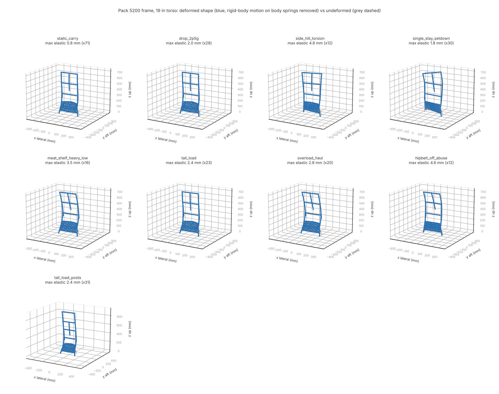
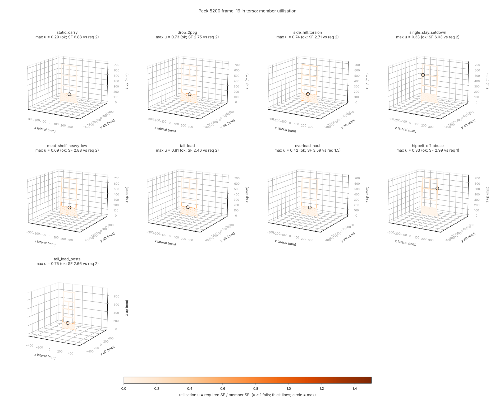

# Pack 5200 frame - all load cases (19 in torso)

## Pack 5200 frame, 19 in torso

Frame: height 0 mm (0.0 in), stays None, torso setting 19 in -> yoke at z = 0 mm, haul mode = False.

| load case | load | min SF | req. | critical member | buckling factor | bond SF (avg / Volkersen peak) | hip share | pass |
|---|---|---|---|---|---|---|---|---|
| static_carry | 68 kg (150 lb) x 1 g | 6.88 | 2 | plh42 (lumbar_plate) | 23.3 | 16.99 / 9.31 elbow_R | 0.80 | yes |
| drop_2p5g | 68 kg (150 lb) x 2.5 g | 2.75 | 2 | plh42 (lumbar_plate) | 9.3 | 6.80 / 3.72 elbow_R | 0.80 | yes |
| side_hill_torsion | 68 kg (150 lb) x 2.5 g | 2.71 | 2 | plh41 (lumbar_plate) | 8.2 | 6.75 / 3.56 elbow_L | 0.80 | yes |
| single_stay_setdown | 68 kg (150 lb) x 2.5 g | 6.03 | 2 | SL520-UB0 (upper_bar) | inf | 6.36 / 3.48 upper_hub_L | - | yes |
| meat_shelf_heavy_low | 68 kg (150 lb) x 2.5 g | 2.88 | 2 | plh42 (lumbar_plate) | 11.1 | 4.85 / 2.66 elbow_R | 0.80 | yes |
| tall_load | 68 kg (150 lb) x 2.5 g | 2.46 | 2 | plh41 (lumbar_plate) | 10.0 | 4.32 / 2.36 elbow_R | 0.80 | yes |
| overload_haul | 91 kg (201 lb) x 1.5 g | 3.59 | 1.5 | plh42 (lumbar_plate) | 13.8 | 6.04 / 3.31 elbow_R | 0.80 | yes |
| hipbelt_off_abuse | 68 kg (150 lb) x 1.5 g | 2.99 | 1 | CR530-CRmid (crown_leg_R) | 8.4 | 8.87 / 4.86 upper_hub_R | 0.00 | yes |
| tall_load_posts | 68 kg (150 lb) x 2.5 g | 2.66 | 2 | plh41 (lumbar_plate) | 12.4 | 4.93 / 2.70 elbow_L | 0.80 | yes |

Mass of load-path tubes (fittings, bonded nodes, shelf and hardware not included):

| member group | section | material | length mm | mass g (oz) |
|---|---|---|---|---|
| stay_lower_L | composite_tube(od=25, t=1.19, n_plies=8) | cfrp_t300_3k_woven_epoxy_ply | 134 | 18.5 (0.65) |
| stay_upper_L | composite_tube(od=25, t=1.19, n_plies=8) | cfrp_t300_3k_woven_epoxy_ply | 400 | 55.2 (1.95) |
| stay_lower_R | composite_tube(od=25, t=1.19, n_plies=8) | cfrp_t300_3k_woven_epoxy_ply | 134 | 18.5 (0.65) |
| stay_upper_R | composite_tube(od=25, t=1.19, n_plies=8) | cfrp_t300_3k_woven_epoxy_ply | 400 | 55.2 (1.95) |
| lumbar_plate | plate_strip(w=20, t=4) | cfrp_plate_quasi_iso | 1899 | 0.0 (0.00) |
| lumbar_plate_shear | generic(A=122.63, Iy=1, Iz=1, J=1) | plate_shear_equivalent | 2209 | 0.0 (0.00) |
| hip_pivot | tube_round(od=12, t=3) | ti_6al_4v | 110 | 28.4 (1.00) |
| mid_bar | composite_tube(od=22, t=1.19, n_plies=8) | cfrp_t300_3k_woven_epoxy_ply | 230 | 27.7 (0.98) |
| upper_bar | composite_tube(od=22, t=1.19, n_plies=8) | cfrp_t300_3k_woven_epoxy_ply | 230 | 27.7 (0.98) |
| crown_leg_L | composite_tube(od=20, t=1.44, n_plies=10) | cfrp_t300_3k_woven_epoxy_ply | 430 | 56.2 (1.98) |
| crown_leg_R | composite_tube(od=20, t=1.44, n_plies=10) | cfrp_t300_3k_woven_epoxy_ply | 430 | 56.2 (1.98) |
| crown_top_bar | composite_tube(od=22, t=1.19, n_plies=8) | cfrp_t300_3k_woven_epoxy_ply | 230 | 27.7 (0.98) |
| crown_spine | composite_tube(od=20, t=1.19, n_plies=8) | cfrp_t300_3k_woven_epoxy_ply | 300 | 32.7 (1.15) |
| **total tubes** | | | | **404.1 (14.26)** |

Fatigue screen (1.2 g carry, pulsating R = 0, required 1e+05 cycles):

- metal (Kt = 2, Goodman + Basquin): min life inf cycles at pivot_boss (Smax 11 MPa) -> ok
- CFRP: max FI at 1.2 g = 0.174 (limit 0.5) at plh42 -> ok
- bonds: max tau_avg 1.13 MPa vs 6.00 MPa (30% of lap shear) at elbow_R -> ok

## Method and assumptions

- Solver: `huntkit.fea.frame` 3D Euler-Bernoulli frame, 6 DOF/node, members subdivided (2 elements
  per member segment); linear static; linear buckling from the consistent geometric stiffness.
  Verified against closed-form solutions in `tests/test_fea.py`.
- Metal SF = design yield / von Mises at the extreme fibre (peak axial+bending combined with peak
  torsion+transverse shear; conservative). Design yield = MMPDS S-basis when the material record
  has it (7075-T6: 462 MPa), else typical.
- CFRP SF = 1 / Tsai-Wu inverse strength ratio of the worst ply (24 points around the tube wall,
  membrane running loads at the mean radius, Ny = 0), strengths knocked down x0.8 hot/wet and a
  further x0.65 on compression (impact). Wall effective stiffness from CLT (membrane A-matrix).
- ASSUMPTION: body interface springs (global axes) - hipbelt kx 20 / ky 30 / kz 40 N/mm total,
  shoulder yoke 4 / 8 / 10 N/mm, load lifters at the stay tops 0 / 6 / 3 N/mm; the shoulder+lifter
  vertical stiffness is rescaled per case so the hipbelt carries 80 % of the vertical load.
- ASSUMPTION: bag load = equal nodal forces at the bag attachment points plus rigid-link moments for
  the CG offset aft; meat shelf = rigid shelf on the pivots with its tip strapped to mid-frame anchors;
  tall load = weight on the shelf pivots, overturning moment reacted by horizontal lashing at the
  upper lash points. Frame self-weight ignored (<0.5 % of load).
- ASSUMPTION: single-stay set-down = impact force (load x 2.5 g vertical + 0.2 friction) at one
  stay foot balanced by the load's d'Alembert inertia (inertia relief, free-free solve).
- Bonded joints: average bond shear vs lap-shear strength x0.8 hot/wet (SF governs), Volkersen
  elastic peak reported for information; bending treated as axial line load around the bond,
  transverse shear assumed to bear on the socket lip, peel not modelled.
- Fatigue: pulsating 0 -> 1.2 g static-carry stress; metal Goodman + Basquin with Kt = 2;
  CFRP FI limit 0.5; bonds 30 % of lap shear. Screening level only.
- Not covered: local tube crushing at clamps/fittings, fitting/node stress, bearing at shelf pivots,
  large-displacement effects, HDPE framesheet / hipbelt plate (use `huntkit.fea.plate`).
